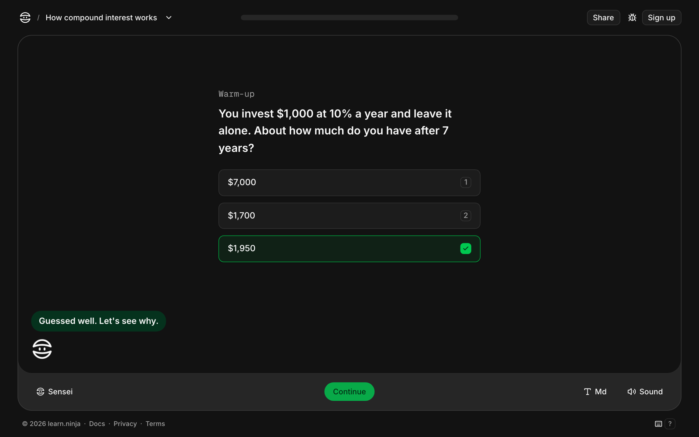
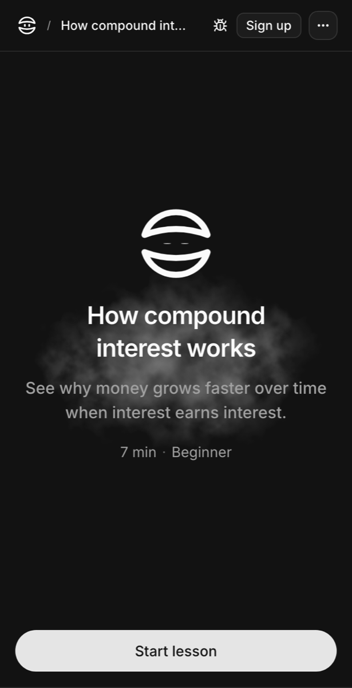
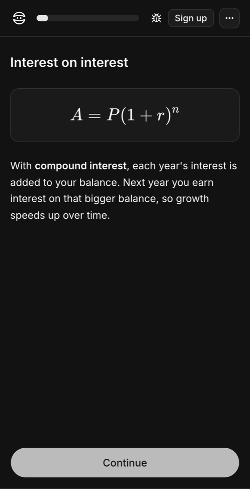
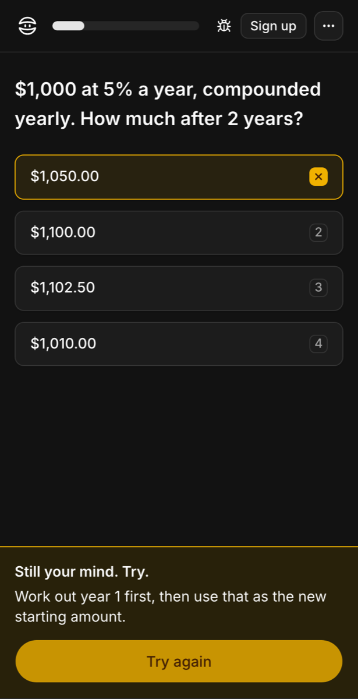

<div align="center">

<a href="https://learn.ninja"></a>

# learn.ninja

**Vibe learn anything with your agent.**

Give your AI agent an article, notes, docs, a transcript, or code. It writes one short, interactive lesson and gives you a link to share. Free, no account.

[](https://github.com/learn-ninja/learn.ninja/actions/workflows/ci.yml) [](LICENSE) [](https://learn.ninja/docs)

[Website](https://learn.ninja) · [Docs](https://learn.ninja/docs) · [Try a lesson](https://learn.ninja/lessons/compound-interest) · [Contributing](CONTRIBUTING.md)

<a href="https://learn.ninja/lessons/compound-interest"></a>

</div>

## Make a lesson

Install the skill in your agent (Claude Code, Codex, Cursor, Gemini CLI, and [more](https://learn.ninja/docs)):

```bash
npx skills add https://learn.ninja -g
```

Then ask it for a lesson from anything: *"Make me a lesson from this article"*, *"Teach my team how our deploy works"*, *"Quiz me on chapter 3"*. The agent writes the lesson, checks it, and publishes it to a link that plays in any browser.

Chat apps (Claude, ChatGPT) connect to the MCP server at `https://learn.ninja/mcp` instead. The [docs](https://learn.ninja/docs) cover both.

## What a lesson is

A lesson is made of **katas**, one per screen, Duolingo- or Brilliant-style: `concept` katas teach, and question katas (`choice`, `compare`, `hotspot`, `sort`, `order`, `match`, `blank`, `scenario`) check what stuck, with instant feedback and hints from the ninja. Lessons are written in any language, right-to-left included, and play on phones.

<table>
  <tr>
    <td width="33%"></td>
    <td width="33%"></td>
    <td width="33%"></td>
  </tr>
  <tr>
    <td align="center">Every lesson plays on phones</td>
    <td align="center">A concept kata teaches one idea</td>
    <td align="center">A wrong answer gets a hint, not the answer</td>
  </tr>
</table>

Try the example lessons (their files are in [`examples/`](examples)):

- [How compound interest works](https://learn.ninja/lessons/compound-interest) (beginner)
- [JavaScript map vs forEach](https://learn.ninja/lessons/map-vs-foreach) (beginner)
- [Basic Spanish greetings](https://learn.ninja/lessons/spanish-greetings) (beginner)
- [Correlation isn't causation](https://learn.ninja/lessons/correlation-vs-causation) (intermediate)
- [Why the Bronze Age collapsed](https://learn.ninja/lessons/bronze-age-collapse) (advanced)

This repository is the whole thing: the website, the lesson player, the lesson format, the `learn` command, and the skill agents install.

## Run it locally

You need Node 24 (see `.nvmrc`) and npm. Nothing else: no database, no accounts, no keys.

```bash
npm install
npm run dev
```

The web app runs at http://localhost:3000: the home page, the docs at `/docs`, and the test lessons at `/lessons/{slug}`. Lessons you publish locally are kept in [PGlite](https://pglite.dev) (Postgres in WebAssembly) under `apps/web/.data/pglite`, rate limits are counted in memory, and sign-in codes and feedback are printed to the server console. `.env.example` lists the variables a hosted deployment uses; none of them are needed here.

To publish to your local server from an agent, set `LEARN_API_URL=http://localhost:3000` before running the skill.

## Commands

| Command | What it does |
| --- | --- |
| `npm run dev` | Start the web app (webpack) |
| `npm run check` | Lint, type-check, and tests across every package. Run it after every change; CI runs it too, plus a production build |
| `npm run build` | Production build |
| `npm run storybook` | Storybook at http://localhost:6006, with every kata type in every state |
| `npm run skill:build -w @workspace/cli` | Rebuild `skills/learn` (bundled CLI, schema, examples) after changing the spec, the CLI, or the examples |
| `npm run schema -w @workspace/spec` | Re-export `packages/spec/schema/lesson.schema.json` after changing the spec |
| `npm run map -w @workspace/player` | Rebuild the map visual's country shapes from Natural Earth |
| `npm run bento -w web` | Redraw the home page's lesson visuals after changing `apps/web/lib/bento-visuals.ts` |
| `npm run favicon -w web` | Rebuild the favicon from `apps/web/app/icon.svg` |
| `npm run share -w web` | Re-render the share images in `brand/` |

A test fails when a generated file is stale, so `npm run check` tells you which of these to run.

## Structure

| Path | What it is |
| --- | --- |
| `apps/web` | Next.js app: home page, docs, lesson player pages, publish API, MCP server |
| `apps/storybook` | Storybook for the player and UI components |
| `docs/` | The docs pages, as Markdown and MDX |
| `packages/spec` | The lesson format: Zod schema, JSON Schema, and the checker's rules |
| `packages/player` | The lesson screens and every kata |
| `packages/ui` | shadcn/ui components on React Aria, shared styles |
| `packages/db` | The Postgres schema (Drizzle) and its migrations |
| `packages/cli` | The `learn` command: sync, validate, and publish lessons |
| `skills/learn` | The installable lesson skill and its teaching guide |
| `examples/` | Test lessons, used as fixtures |

## Contributing

learn.ninja is built by a few people, so help goes a long way. These are the places we'd most like it:

- **Languages:** translate the player's interface into your language, or fix right-to-left issues.
- **Visuals:** new map regions, charts, diagrams, chess boards, molecules.
- **Sounds and motion:** better sound effects, transitions, and celebration moments.
- **The teaching guide:** help agents write better lessons, and add example lessons.
- **Docs, bugs, and accessibility:** always welcome as a pull request, no proposal needed.

New to the code? Pick one of the [good first issues](https://github.com/learn-ninja/learn.ninja/issues?q=is%3Aissue%20is%3Aopen%20label%3A%22good%20first%20issue%22). Changes to the lesson format, new kata types, agent round trips, and the ninja's voice start as an [Idea issue](https://github.com/learn-ninja/learn.ninja/issues/new?template=idea.yml). [CONTRIBUTING.md](CONTRIBUTING.md) has the details, the conventions, and how review works; agent-written pull requests are welcome too.

Found a security issue? See [SECURITY.md](SECURITY.md). Everyone taking part follows the [Code of Conduct](CODE_OF_CONDUCT.md).

## License

The code is [Apache-2.0](LICENSE). The example lessons in `examples/` and the docs in `docs/` are [CC-BY-4.0](LICENSE-CONTENT). The learn.ninja name, the logo, the files in `brand/`, and the ninja character are trademarks of Uxcel Inc; see [TRADEMARK.md](TRADEMARK.md) for what forks may and may not do with them.
